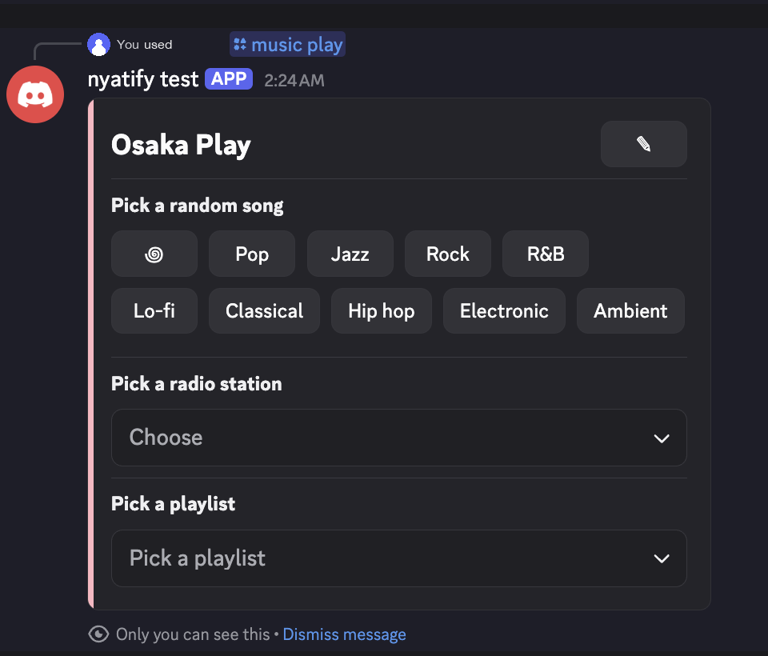
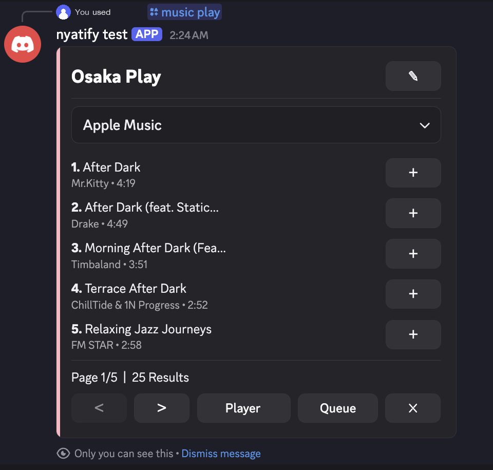
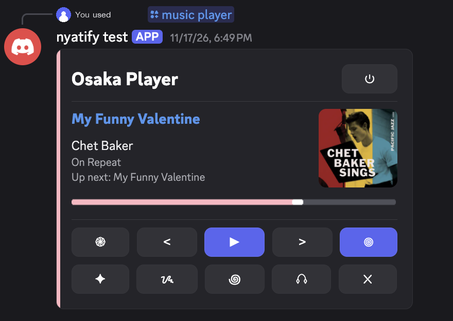
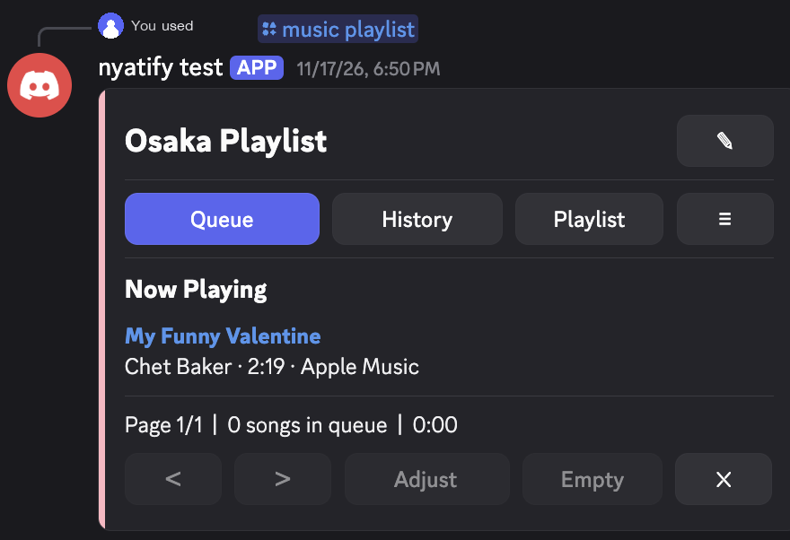

# 🎵 音乐

[English](music.md) | 简体中文

在语音频道里放歌。可以搜歌名或贴链接；不填参数时，会打开面板，让你从风格、电台或已保存的歌单里选。

播放器卡片会留在文字频道。使用这些命令前，请先加入语音频道。

# 🎛️ 功能

## Music Play - 搜歌

<code>/music play<span class="arg arg-blank" title="不填"></span></code>：搜索栏什么都不填，打开 Osaka Play，从风格、电台或已保存的歌单里选歌。



<code>/music play<span class="arg">song name</span></code>：按歌名搜索，可切换音源网站，再按 ＋ 加入队列。



## Music Play - 播放器

`/music player`：打开正在播放的卡片，用来暂停、切歌、调音量，也可以随机、单曲循环、开电台或收藏。



## Music Play - 歌单

`/music playlist`：查看正在排队的歌、听过的记录，以及保存下来的歌单。



# ⌨️ 命令

| 命令 | 说明 |
| --- | --- |
| `/music play` | 播放一首歌或一条链接。不填参数时打开选歌面板。 |
| `/music player` | 打开正在播放的卡片。 |
| `/music playlist` | 查看队列、听过的歌，以及已保存的歌单。 |

# 🔐 访问

写入 `config.txt` 时不要加引号。

**Lavalink**

> 1. 准备一个能搜索 Apple Music、YouTube、Spotify 和 SoundCloud 的 Lavalink 节点。
> 2. 填入 `LAVALINK_URI` 和 `LAVALINK_PASSWORD`。这两项不填，放歌功能无法启动。
> 3. 地址示例：`http://127.0.0.1:2333`。
> 4. 也可以使用 [Free-Lavalink](https://github.com/AjieDev/Free-Lavalink) 上的公开节点。

**NodeLink**

> 只有网易云音乐走这个节点，其余音源仍用上面的 Lavalink。
>
> 1. 准备一个 NodeLink 节点。
> 2. 填入 `NODELINK_URI` 和 `NODELINK_PASSWORD`。
> 3. 不填的话，网易云音乐也会改走 Java 节点。
> 4. 地址示例：`http://127.0.0.1:2334`。

**Last.fm**

> 按电台时，会向 Last.fm 要一首相近的歌。没有密钥时，就继续用当前歌名搜索。
>
> 1. 到 [last.fm/api/account/create](https://www.last.fm/api/account/create) 申请 API 账号。
> 2. 把密钥写入 `LASTFM_API_KEY`，也可以第一次按电台按钮时再贴上。

# 🎨 自定义

可以直接改 `music/player/layout.py` 和 `music/lavalink.py`。

```python
# music/player/layout.py
TITLE = "## Osaka Player"

# music/play/discover.py
TITLE = "## Osaka Play"

# music/playlist/card.py
TITLE = "## Osaka Playlist"

# music/player/album.py
ALBUM_TITLE = "## Osaka Albums"
ALBUM_SECONDS = 45.0  # 45 秒

# music/lavalink.py
IDLE_SECONDS = 5 * 60  # 5 分钟

# music/playback/remember.py
QUEUE_SONGS = 15
HISTORY_SONGS = 50

# music/archive.py
PLAYLIST_LIMIT = 5
SONG_LIMIT = 100

# announce.py
ACCENT_COLOR = "#FFB6C1"
```
