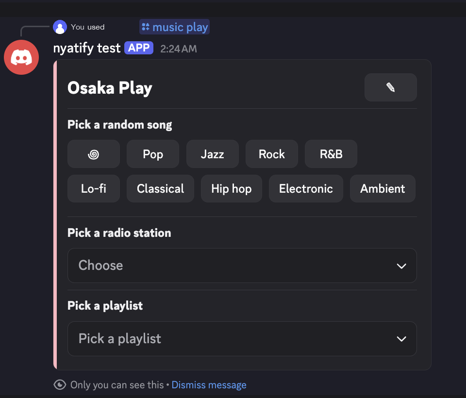
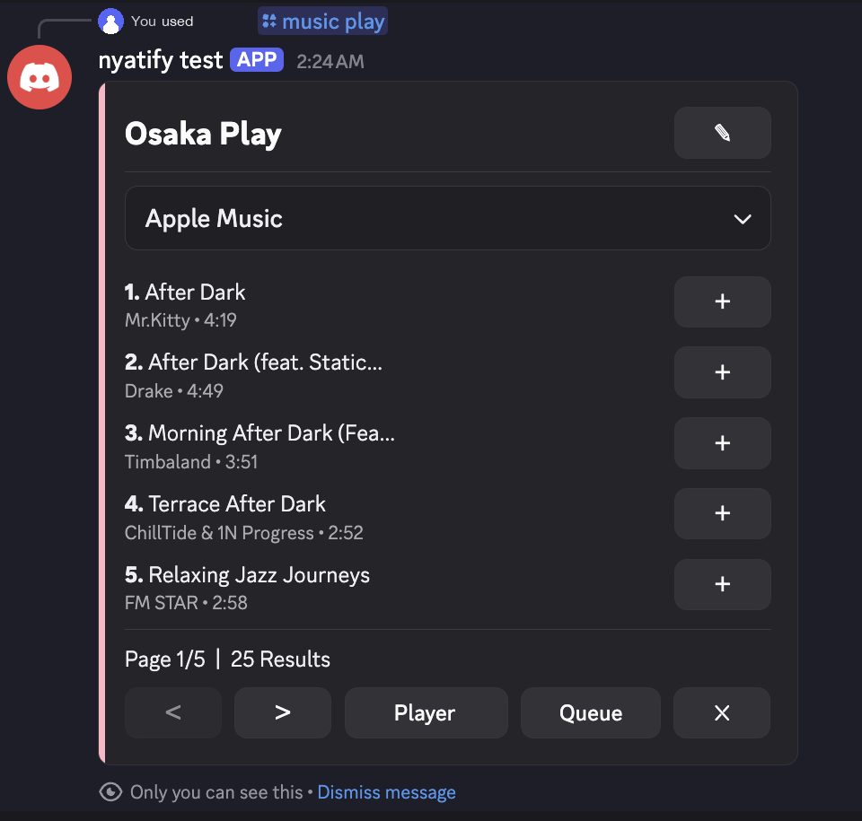
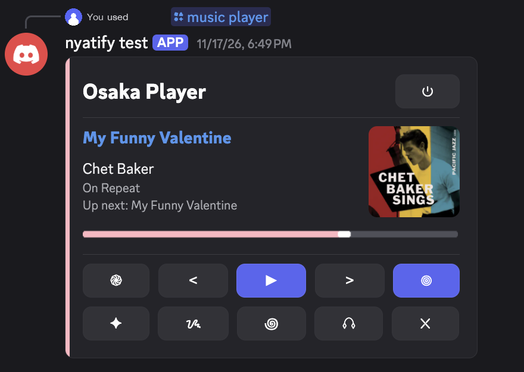
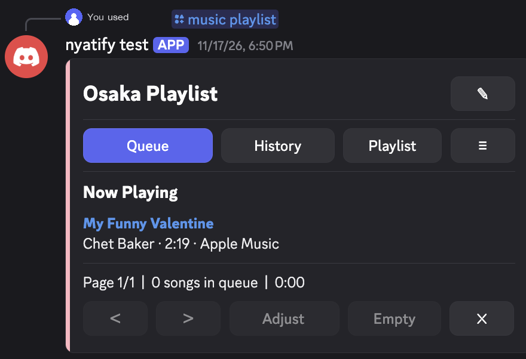

# 🎵 Music

English | [简体中文](music.CN.md)

Play a song in a voice channel. A name or a link, a genre, a station, or a saved list.

The player card stays in the text channel. Join a voice channel first.

# 🎛️ Functions

## Music Play - Search Songs

<code>/music play<span class="arg arg-blank" title="leave blank"></span></code>: leave the search blank, then pick a genre, a station, or a saved list.



<code>/music play<span class="arg">song name</span></code>: switch the site, then ＋ to queue.



## Music Play - Player

`/music player`: pause, skip, volume, shuffle, repeat, radio, and save.



## Music Play - Playlist

`/music playlist`: the queue, history, and saved lists.



# ⌨️ Commands

| Command | Description |
| --- | --- |
| `/music play` | Play a song or a link. Leave it empty to pick a random song. |
| `/music player` | Show the music player. |
| `/music playlist` | Show the queue, playlists, and songs already played. |

# 🔐 Access

In `config.txt`, write the value without quotes.

**Lavalink**

> 1. Run a Lavalink node that can search Apple Music, YouTube, Spotify, and SoundCloud.
> 2. Set `LAVALINK_URI` and `LAVALINK_PASSWORD`. Empty leaves play unable to start.
> 3. Example URI: `http://127.0.0.1:2333`.
> 4. Or pick a public node from [Free-Lavalink](https://github.com/AjieDev/Free-Lavalink).

**NodeLink**

> NetEase uses this node. Java Lavalink keeps the other sites.
>
> 1. Run a NodeLink node.
> 2. Set `NODELINK_URI` and `NODELINK_PASSWORD`.
> 3. Empty keeps NetEase on the Java node.
> 4. Example URI: `http://127.0.0.1:2334`.

**Last.fm**

> Radio asks Last.fm for a similar song. Empty keeps searching the current title.
>
> 1. Create an API account at [last.fm/api/account/create](https://www.last.fm/api/account/create).
> 2. Set `LASTFM_API_KEY`, or paste the key the first time you press radio.

# 🎨 Customization

You are allowed to make changes manually in `music/player/layout.py` and `music/lavalink.py`.

```python
# music/player/layout.py
TITLE = "## Osaka Player"

# music/play/discover.py
TITLE = "## Osaka Play"

# music/playlist/card.py
TITLE = "## Osaka Playlist"

# music/player/album.py
ALBUM_TITLE = "## Osaka Albums"
ALBUM_SECONDS = 45.0  # 45 seconds

# music/lavalink.py
IDLE_SECONDS = 5 * 60  # 5 minutes

# music/playback/remember.py
QUEUE_SONGS = 15
HISTORY_SONGS = 50

# music/archive.py
PLAYLIST_LIMIT = 5
SONG_LIMIT = 100

# announce.py
ACCENT_COLOR = "#FFB6C1"
```
