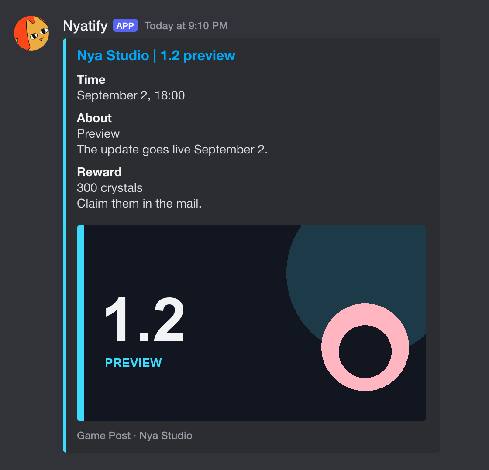

# 📰 动态

[English](news.md) | 简体中文

这里有体育俱乐部或电竞战队的比赛卡片，也有哔哩哔哩或微博账号的动态。

卡片会发到当前服务器的动态通知频道，用 `/announce feature` 指定这个频道。

# 🖼️ 示例



# ⌨️ 命令

| 命令 | 说明 |
| --- | --- |
| `/news add` | 关注一个账号。 |
| `/news feature` | 给已经关注的账号设话题。 |
| `/news delete` | 取消关注。 |
| `/news show` | 看看关注了哪些账号。 |
| `/news check` | 预览最近的一条动态，或者下一场比赛。仅限所有者。 |
| `/news cookie` | 写入登录 Cookie；什么都不填就显示当前状态。仅限所有者。 |

# 🔑 要点

**比赛**：**TheSportsDB** 上的体育俱乐部，或 **PandaScore** 上的电竞战队。

**游戏、门票和其他**：**哔哩哔哩**或**微博**账号。账号还没设置话题时，不会发出任何动态。

**开赛**：比赛卡片最早在开赛前 6 小时出现。

**没比赛的日子**：开赛前 6 小时里如果没有比赛，大约一天才查一次。

**完赛**：完赛过了一天半，比赛卡片就会删掉。

**来源**：<u>只支持**哔哩哔哩**和**微博**。</u>

**Cookie**：登录 Cookie 写在 `config.txt` 里。获取方法写在下面的「访问」。

**所有者命令**：还没用过 `/admin` 的话，看不到 `/news check` 和 `/news cookie`。

# 🔐 访问

写进 `config.txt` 时不要加引号。

**PandaScore**

> 1. 到 [app.pandascore.co/signup](https://app.pandascore.co/signup) 注册。
> 2. 打开[后台](https://app.pandascore.co/dashboard/main)，把 token 复制出来。
> 3. 填进 `PANDASCORE_TOKEN`。留空就跳过 PandaScore。

**TheSportsDB**

> 不用登录。`THESPORTSDB_KEY` 留空会用免费的测试密钥。

**哔哩哔哩**

> 1. 先登录 [bilibili.com](https://www.bilibili.com)。
> 2. 复制 Cookie 请求头，里面要有 `SESSDATA`、`bili_jct` 和 `DedeUserID`。
> 3. 再到这个网站的 localStorage 里复制 `ac_time_value`。
> 4. 分别填进 `BILI_COOKIE` 和 `BILI_AC_TIME`。
> 5. [怎么复制 Cookie](https://github.com/ParrotXray/lavabili-plugin#manual-method-browser-devtools)。

**微博**

> 1. 先登录 [m.weibo.cn](https://m.weibo.cn)。
> 2. 复制 `SUB` 这张 Cookie。
> 3. 填进 `WEIBO_COOKIES`。留空的话，下次轮询时机器人会生成一个访客 `SUB`。

**指南**：[怎么复制 Cookie](https://github.com/dataabc/weibo-crawler#如何获取cookie可选)。

# 🔁 代理

哔哩哔哩和微博各有一份代理列表。留空就直连。比赛卡片不走代理。

**添加**：地址写在 `config.txt` 里，不要加引号。多个地址用逗号隔开。

```
BILI_PROXY 是给哔哩哔哩的，WEIBO_PROXY 是给微博的。比如 http://127.0.0.1:7890,http://127.0.0.1:7891。
```

**一个代理**：这个平台的账号都使用这一个代理。哔哩哔哩的手机号和微博访客，会固定留在创建它们时的那个代理上。

**多个**：这些账号会按你填写的顺序，分配到各个代理上。

```
哔哩哔哩每次轮询都会从下一个代理开始。每个代理分配 BILI_PHONES_PER_PROXY 个手机号，每个手机号负责 BILI_ACCOUNTS_PER_PHONE 个账号。这两个的默认值分别是 1 和 2。

微博会把同一批账号留在同一个代理上。访客不会被调到别的代理。
```

**跳过的代理**：出口检查没通过，或者出口 IP 跟其他代理一样的，这一轮先不使用。它上面的账号会交给其余还可用的代理。把 `IP_CHECK` 设成 `0` 就跳过这项检查。

**登录**：保存下来的登录只会使用第一个代理。

# 🎨 自定义

可以直接改 `news/cards.py` 和 `news/source/match/common.py`。

改提示词，告诉模型哪些动态要留下，卡片上写什么。

```python
# news/prompt/post/filter.py
# FILTER_PROMPT：game、ticket。决定留下哪些动态。

# news/prompt/post/write.py
# WRITE_PROMPT：game、ticket、other。卡片上写什么。

# news/prompt/match/write.py
# MATCH_WRITE_PROMPT：赛后回顾。比赛没有筛选这一步。

# news/cards.py
_BILIBILI_COLOR = "#3DDCFF"
_WEIBO_COLOR = "#C25454"
_MATCH_COLOR = "#228B22"

# news/source/match/common.py
PREVIEW_BEFORE = timedelta(hours=6)
IDLE_REFRESH = timedelta(hours=24)
DELETE_AFTER_END = timedelta(days=1, hours=12)
```
