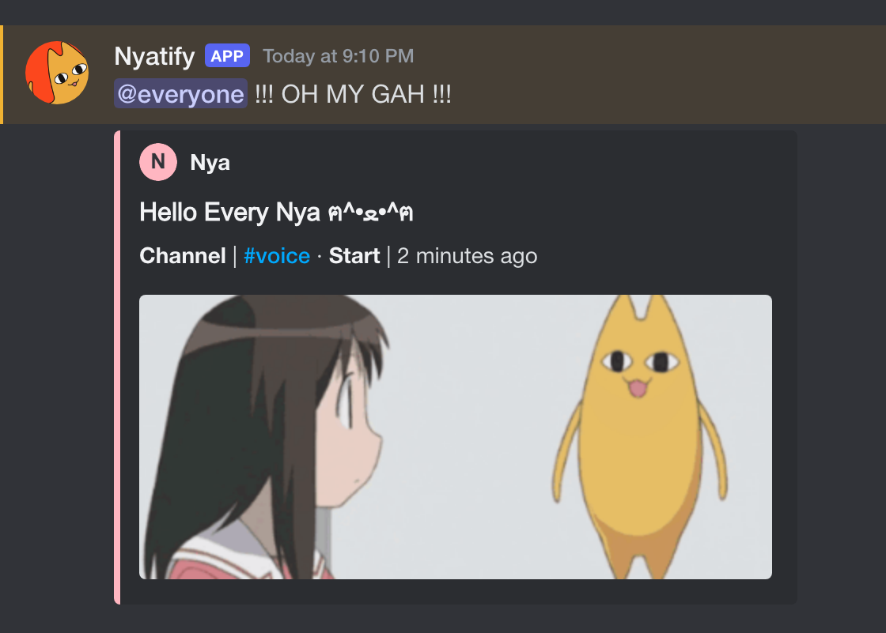

# 🔊 语音

[English](voice.md) | 简体中文

有人加入一个空着的语音频道或舞台频道时，发一条通知。

卡片会发到当前服务器的语音通知频道。

# 🖼️ 示例



# ⌨️ 命令

| 命令 | 说明 |
| --- | --- |
| — | 没有专门的命令。 |

# 🔑 要点

**空频道**：通知只在有人加入空着的语音频道或舞台频道时发出。

**机器人和 AFK**：机器人加入频道不会发出通知，挂机频道里也不会发。

**一条通知**：人还留在频道里时，不会再发第二条通知。

**返回**：离开频道后，如果 45 秒内回来，通知还是原来那一条。

**保留时间**：这条消息过 15 分钟会删掉。

# 🎨 自定义

可以直接改 `cogs/voice_notify.py`。

默认图标 / 横幅：`image/nyatify_icon.png` / `image/nyatify_banner.png`

```python
# cogs/voice_notify.py
VOICE_NOTICE_CONTENT = "@everyone !!! OH MY GAH !!!"
VOICE_NOTICE_TITLE = "Hello Every Nya ฅ^•ﻌ•^ฅ"
# VOICE_NOTICE_GIF_URLS：400×180。
NOTICE_TTL_SECONDS = 15 * 60  # 15 分钟
RECONNECT_GRACE_SECONDS = 45.0  # 45 秒

# announce.py
ACCENT_COLOR = "#FFB6C1"
```
